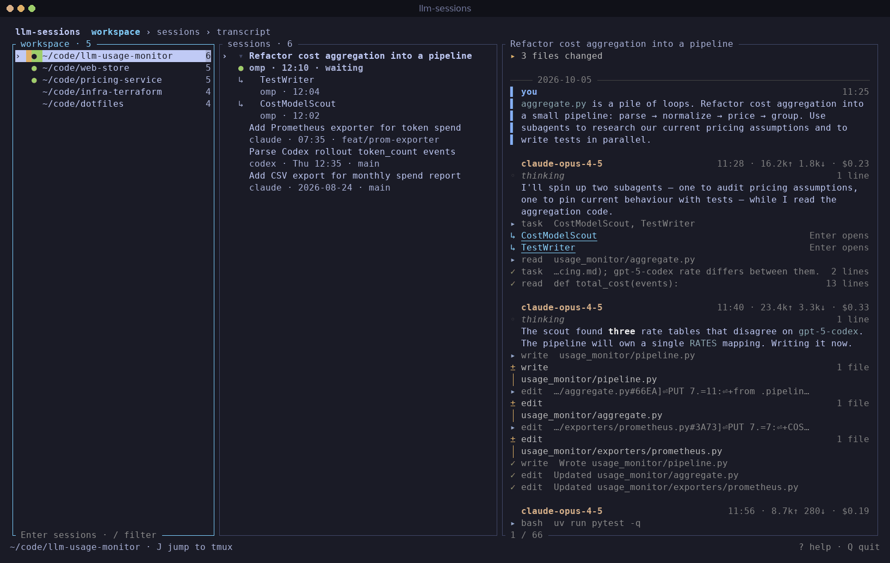
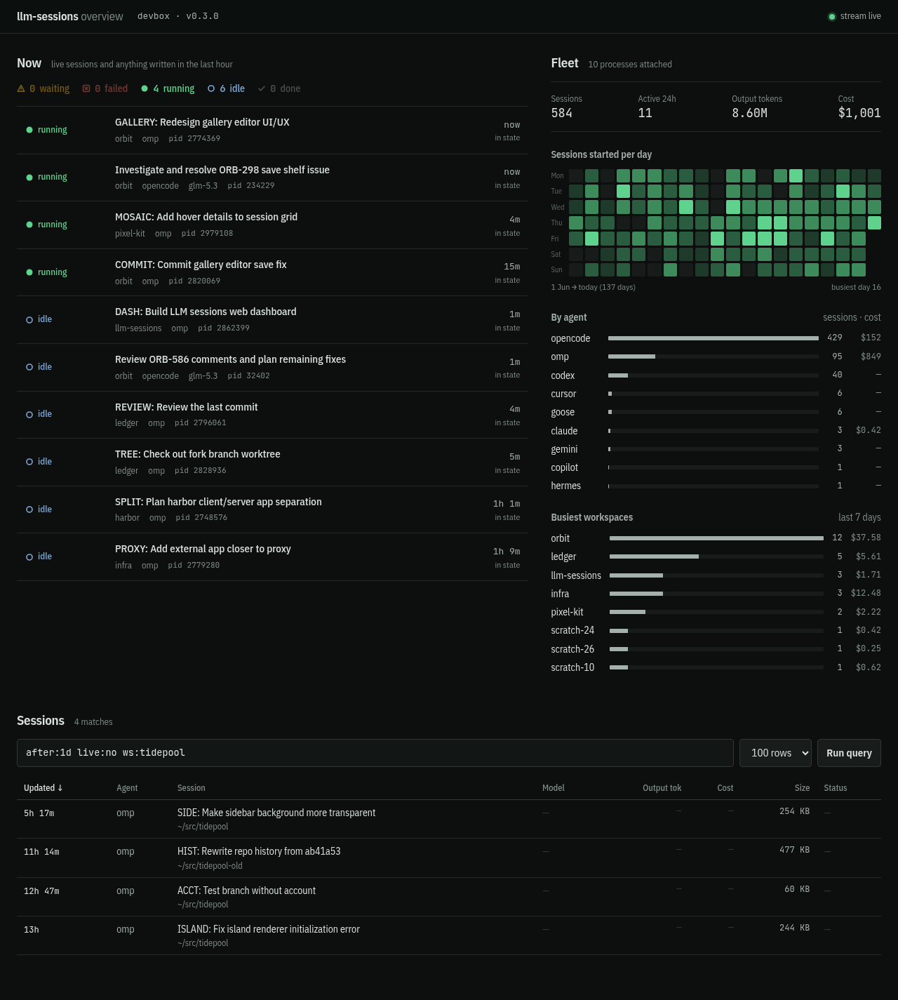

# llm-sessions

> Workspace-first explorer for local LLM coding-agent sessions.

Reads every coding agent's history and answers one question: **what happened in _this project_?**

```
$ llm-sessions workspaces
 102  ~/code/web-store         claude omp opencode
  43  ~/code/pricing-service   codex omp opencode
 101  ~/code/llm-usage-monitor codex opencode
```

Run with no arguments to browse workspaces → sessions → transcripts, all
agents merged into one list.

## Screenshots

**Terminal UI** (`llm-sessions`)



**Web dashboard** (`llm-sessions serve --dashboard`)



<details>
<summary>More screenshots</summary>

| Timeline view `6`, insert mode `i` | Full-text search `s` |
|---|---|
|  |  |
| **Fullscreen reader `Ctrl-W o`** | **Help `?`** |
|  |  |

</details>

## Install

```sh
cargo install llm-sessions   # or `cargo install --path .` from a checkout
```

Requires Rust 1.96+. Linux only (liveness reads `/proc`). Features `serve`
and `http` are on by default; `--no-default-features` builds an SSH-only
CLI/TUI.

## Sources

| Agent | Store |
|---|---|
| OMP | `~/.omp/agent/sessions/<bucket>/*.jsonl` |
| Claude Code | `~/.claude/projects/<dir>/*.jsonl` |
| Codex | `~/.codex/sessions/**/rollout-*.jsonl` + `state_5.sqlite` |
| OpenCode (v1, v2) | `~/.local/share/opencode/opencode.db` |
| Copilot CLI | `~/.copilot/session-store.db` + `session-state/` |
| Kilo | `~/.local/share/kilo/kilo.db` |
| Goose | `~/.local/share/goose/sessions/*.jsonl` + `projects.json` |
| Cursor CLI | `~/.cursor/projects/*/agent-transcripts/**/*.jsonl` |
| Gemini CLI | `~/.gemini/tmp/<hash>/chats/*.json` |
| Hermes | `~/.hermes/state.db` |
| OpenClaw | `~/.openclaw/agents/*/sessions/*.jsonl` + `sessions.json` |

Missing agents are skipped; a failing source shows a status-bar warning.
Not supported: Cursor GUI, Antigravity, Devin.

## Commands

```sh
llm-sessions                     # interactive explorer
llm-sessions list                # newest 50 sessions (--json, -q '<query>', --format, -0)
llm-sessions workspaces          # project totals, live first
llm-sessions show <id>           # transcript; --thinking --tools, --format md -o out.md
llm-sessions index               # build/update the optional text index
llm-sessions search <words>      # full-text search
llm-sessions digest --since 24h  # recent activity by project
llm-sessions top                 # one row per running agent
llm-sessions usage --by workspace --since 7d   # also: model, agent, day
llm-sessions archive <id>        # --undo restores
llm-sessions serve --token <t>   # read-only HTTP/WebSocket API
llm-sessions hosts               # remote hosts
llm-sessions sources             # detected stores and scan costs
llm-sessions doctor              # diagnostics (--json)
llm-sessions completions bash
llm-sessions man
```

`--read-only` blocks every write: archiving, indexing, origin init, host
edits, tmux focus, bookmarks.

## Keys

| Key | Action |
|---|---|
| `j` `k` `↓` `↑`, `PgDn` `PgUp`, `g` `G` | move, page, top/bottom |
| `Enter` / `Esc` | open / back; `Enter` on a delegating tool call opens the subagent |
| `→` `l` / `←` `h`, `Tab` | focus pane right / left |
| `]` `[` / `1`…`6` | cycle / jump to views: workspace, agent, branch, fleet, host, timeline |
| `/` `s` `x` `Ctrl-R` | filter / search / clear / rescan |
| `f` | follow the session live |
| `J` | jump tmux focus to the selected live session |
| `z a` `z c` `z o` / `z M` `z R` | fold one session's subagents / all |
| `a` `e` | toggle archived / only live |
| `Space` `v` `V` / `d` `u` | select one / visible / group; archive / restore |
| `t` `o` `c` | unfold thinking / tool output / changed files |
| `y y` `y A` `y r` `y i` `y p` | copy reply / transcript / resume command / id / file path |
| `Ctrl-W o` `F11` | fullscreen reader |
| `r` | quit, printing the resume command (paste it; don't use `$(…)`) |
| `i` | insert: send one message to the selected session |
| `m` `'` `` ` `` | set / jump to bookmarks |
| `?` `F1` | help |
| `q` / `Q` `Ctrl-C` | back / quit |

Copying needs `wl-copy`, `xclip`, `xsel`, `pbcopy`, or `clip.exe`.

`i` runs the agent's headless CLI in the session's directory (30 min
timeout). One writer per conversation:

- **OMP, Hermes**: idle sessions only; attached sessions are refused (use `J`).
- **OpenCode**: sends via the live client's loopback server, else `opencode run --session <id>`.

Subagents, remote rows, and `--read-only` are refused.

## Liveness

| | Meaning |
|---|---|
| `●` | exact: a process holds the session file open |
| `○` | inferred: matching agent with cwd inside the workspace |
| `·` | written recently, nothing attached |
| ` ` | stale |

## Query language

One grammar across `/`, `s`, `list -q`, and the API:

```
source:omp  agent:codex  ws:dstm  branch:feat/x  model:glm  host:nx-1
id:01a0  after:7d  before:today  cost:>1
live:yes  archived:only  body:naming  bare words = free text
```

`body:` needs `llm-sessions index`. Unknown keys become free text.

## Remote hosts

Configure in `$XDG_CONFIG_HOME/llm-sessions/hosts.json`, or via
`llm-sessions hosts add|remove|refresh`:

```json
{ "hosts": [
  { "name": "nx-1", "ssh": "nx-1.example.net", "sources": ["hermes"] },
  { "name": "worker", "url": "https://worker.example.net", "token_env": "WORKER_TOKEN" }
] }
```

- Remote sessions appear beside local ones (`--host`, `host:`, view `5`).
- SSH uses `BatchMode=yes`; passphrase-protected keys fail fast.
- HTTP peers (`url` + `token_env`) support listing and transcripts, not
  resume, insert, or `top`. Set `SSL_CERT_FILE` for a private CA.
- Peers running `llm-sessions` also expose their own hosts (up to 8 hops).
  Older or missing binaries fall back to a shell script that lists local stores.

**Identity.** Each machine has a UUID at
`$XDG_STATE_HOME/llm-sessions/origin-id`, created on first run
(`llm-sessions origin --init` to do it explicitly). Sessions reached by several
routes are merged by `(origin, source, id)`. Peers are pinned by UUID; run
`llm-sessions hosts refresh <name>` to enroll or re-pin. Keep the file across
upgrades; give cloned machines a new one. A peer whose own `llm-sessions`
predates identity never created its marker: `llm-sessions hosts refresh --init
<name>` creates it on the peer over ssh — no upgrade needed — then enrolls it
(`--force` also replaces a valid one, rekeying the peer). HTTP peers manage
their own marker.

Use `show <id> --origin <uuid> --source <agent>` if IDs collide.

## Serve

```sh
LLMS_TOKEN=$(openssl rand -hex 32) llm-sessions serve --bind 0.0.0.0:8787
curl -H "Authorization: Bearer $LLMS_TOKEN" 'http://host:8787/v1/sessions?q=live:yes'
```

| Route (all `GET`) | Returns |
|---|---|
| `/v1/healthz` | version and host, no token |
| `/v1/sessions?q=<query>&limit=N` | `list --json` rows plus `status` |
| `/v1/sessions/<id>` | one row |
| `/v1/sessions/<id>/transcript` | `show <id> --json` |
| `/v1/stream` | WebSocket snapshots on change, ping every 20 s |
| `/v1/federation/*` | peer discovery for other `llm-sessions` instances |

- Read-only: no writes, no resume.
- Token required (≥16 chars). `--no-auth` works on loopback only.
- No TLS: put a reverse proxy in front when off loopback.
- `--cors-origin <url>` allows a browser page on another origin.
- `--source` / `-q` restrict what is published.
- `--federate` also publishes sessions from configured remote hosts.

`status` is `running`, `idle`, `waiting`, `failed`, or `done`, guessed from
liveness and the transcript tail.

## Design notes

- **No index for browsing.** A full scan takes ~80 ms; the TUI rescans every 2 s.
- **Workspaces roll up** to their repository; worktrees map to the main one.
- **Subagents and forks are trees** nested under their parent.
- **Agent stores are read-only.** Only archiving writes, natively where the
  agent supports it, otherwise to an overlay db. Credential files are never opened.
- **Unknown records survive** as folded raw JSON; a session always opens.

## Storage

| Path | What |
|---|---|
| `$XDG_STATE_HOME/llm-sessions/overlay.db` | archive state for agents without it |
| `$XDG_CACHE_HOME/llm-sessions/index.db` | search index; safe to delete (~690 MB per 5 GB of text) |
| `$XDG_STATE_HOME/llm-sessions/origin-id` | machine UUID; keep it |

## Development

Source lives in `src/{catalog,source,storage,runtime,output,tui,cli,serve}`.
CI runs fmt, pedantic clippy, rustdoc, tests, and `cargo audit`.

## License

MIT
